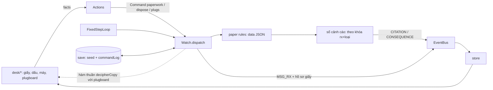

# Desk UI G3 — Design

Trạng thái: **ĐÃ DUYỆT 2026-11-04**. Đi kèm `requirements.md`.

## 1. Kiến trúc

Nguyên tắc: **sim quyết định hậu quả**, desk chỉ báo sự thật quan sát được. Cảnh cáo, ngưỡng, hạn giờ đều tất định theo seed và log.

## 2. Thay đổi sim-core (cần duyệt)

| Mục | Thay đổi | Ghi chú |
|---|---|---|
| Dữ liệu | `data/paper.json`: luật lỗi, trọng số, ngưỡng 3/5, hạn giờ, lệnh lưu/hủy theo ngày, xác suất tell giấy | cân bằng nằm ngoài code |
| `messages.ts` | hồ sơ giấy (`authMark`, `signatureVariant`, `senderApproved`, `senderId`) sinh bằng `derive(seed, "paper", rxId)`; `verifyTells` trả thêm tell giấy | giữ D8 |
| `events.ts` | thêm `CITATION`, `CONSEQUENCE`; `WATCH_END.reason` thêm `"executed"`; `MSG_RX` thêm trường giấy công khai | đổi hợp đồng sự kiện |
| `watch.ts` | lệnh mới: `paperwork {rxId, facts}`, `dispose {rxId, how}`, `timeout` (do sim tự phát khi hết hạn sim-time); sổ cảnh cáo idempotent | replay từ log |
| `traffic.ts` | `decipherCopy(seed, day, indicator, copy, plugboard?)` | tham số thứ năm tùy chọn, mặc định khóa ngày |
| `index.ts` | xuất hàm mới qua barrel | D2 |

Không đổi: Enigma, auth, sonar, boat, detection ngoài hậu quả R1.3.

## 3. Chấm luật

`paperwork` mang **sự kiện quan sát** (dấu nào ở mặt nào, màu, đã ký chưa, bó nào, thùng rác/ngăn hồ sơ/lò). Sim so với bảng luật (`data/paper.json`) và sinh 0..n lỗi. Khóa idempotent: `(rxId, loại lỗi)`. Ví dụ:

| Lỗi | Điều kiện |
|---|---|
| `wrongStamp` | dấu thường trên Input, hoặc Output có dấu không đỏ hoặc ≠ 1 dấu |
| `wrongBin` | giấy nhiệm vụ/Orders vào thùng rác |
| `badHandover` | thiếu Echo, thiếu chữ ký, bó có hơn một bức điện |
| `timeout` | `tSec > rxTSec + deadlineSec` khi đồng hồ bật và chưa giao |
| `orderBreach` | làm trái lệnh lưu/hủy của ngày |

Giới hạn chống gian lận: client trung thực báo đúng sự thật. Khi lên server có thẩm quyền, server giữ trạng thái giấy (hoặc nhận chuỗi thao tác thay vì ảnh chụp trạng thái). Việc đó nằm ngoài G3 nhưng hợp đồng `paperwork` được thiết kế để thay thế được (câu hỏi mở 4).

## 4. Tell giấy

Sinh trong sim từ seed. Quan sát được: dấu xác thực, mẫu chữ ký (một trong N biến thể vẽ từ `signatureVariant`), cờ người gửi được duyệt (so với danh sách trên Orders), `senderId` bản mã.

- Tin thật: `authMark ∈ {genuine, none}` theo mạng, chữ ký khớp mẫu, người gửi được duyệt.
- Tin giả: chọn ngẫu nhiên có trọng số từ Intel: dấu giả y hệt (không tell), chữ ký lệch, người gửi lạ, hoặc kết hợp; bất biến D8 chặn trường hợp chỉ có dấu giả y hệt mà không có tell khác.
- Test bất biến: với 1000 seed, mọi tin giả có ≥ 1 tell kiểm chứng được và `verifyTells` không bao giờ dùng `authMark` giả y hệt làm tell.

## 5. Plugboard

Máy G2 dùng `dayEnigma` (có plugboard) bên trong `decipherCopy`. G3: UI cắm dây vào bảng 26 chữ, gửi các cặp vào `decipherCopy(..., plugboard)`; cặp lỗi bị từ chối ở biên (validate). Máy replay `replayCopy` ở desk nhận cùng tham số để cửa sổ/đèn khớp. Property test: máy desk = `decipherCopy` với mọi plugboard hợp lệ.

## 6. Giờ và tất định

Hạn giờ G3 dùng thời gian sim. Chỉ báo G2 (thời gian thực) bị thay bằng đếm ngược sim-time; đồng hồ tạm dừng khi pause sim tự nhiên. Hết hạn là sự kiện của sim, replay giống từng bit.

## 7. Save và tương thích

Đề xuất: bump save lên v3 chỉ khi dùng lệnh G3. Save v2 vẫn nạp (chơi như G2, không cảnh cáo). Test: replay v2, replay v3, UI P5/classic không gửi lệnh G3.

## 8. Câu hỏi mở (cần người vận hành quyết trước khi làm)

1. ~~**Mức phạt**~~ **ĐÃ CHỐT 2026-11-04** (người vận hành): lần 1–2 nhắc nhở, trừ điểm, mất thông tin quan trọng, bị địch đánh dấu; lần 3 địch biết ~80% vị trí và đánh bom tàu; lần 5 bị thuyền trưởng kéo ra ngoài tàu hành quyết. Ánh xạ vào sim: lần 1–2 = `INTEL_LEVEL`+1 (hazard HF/DF tăng theo `intelHazardStep`); lần 3 = `HFDF_FIX` độ tin cậy 0.8 + `ESCORT_DISPATCHED` + `DEPTH_CHARGE` (cơ chế sẵn có, người chơi vẫn có thể lặn/đổi hướng); lần 5 = `WATCH_END "executed"`.
2. ~~**Xử tử**~~ **ĐÃ CHỐT**: kết thúc ca kèm cảnh kết (thuyền trưởng kéo ra ngoài tàu).
2b. ~~**Lần 4**~~ **ĐÃ CHỐT**: mất thông tin và tăng mức nghiêm trọng (`CONSEQUENCE "severe"`: mất thêm một mục, đánh dấu thêm, định vị lại độ tin cậy 0.9, escort thứ hai gần hơn).
3. ~~**Save**~~ **ĐÃ CHỐT** ("làm save"): lệnh mới đi vào `commandLog`; định dạng file save v2 giữ nguyên (thêm kiểu lệnh là tương thích ngược), `parseCommand` ở radio-ui validate từng kiểu lệnh mới. Save cũ nạp như trước, không có cảnh cáo.
4. ~~**Chống gian lận**~~ **ĐÃ CHỐT** (theo đề xuất): chấp nhận `paperwork` do client báo ở G3; giới hạn ghi ở mục 3.
5. ~~**Hạn giờ**~~ **ĐÃ CHỐT**: 120 giây sim-time, chung mọi loại tin.
6. ~~**Lệnh lưu/hủy**~~ **QUYẾT ĐỊNH (người vận hành giao cho tôi)**: 3 lệnh theo ngày, chọn bằng `derive(seed, "orders", day)`: "hủy Input sau khi giao", "lưu bản Output vào ngăn hồ sơ", "không lưu gì (chỉ giao)". Làm trái lệnh = `orderBreach`.
7. ~~**Chữ ký mẫu**~~ **QUYẾT ĐỊNH (giao cho tôi)**: 6 biến thể vẽ vector nhỏ (nét ngắn sinh từ `signatureVariant`), gán `TEMPORARY`, không chép game tham chiếu.
8. ~~**Mất thông tin quan trọng**~~ **ĐÃ CHỐT**: tọa độ an toàn và điểm có thể tiếp tế (4 mục sinh từ seed: 2 tọa độ an toàn, 2 điểm tiếp tế), thu hồi từng mục ở cảnh cáo 1, 2, 4.
