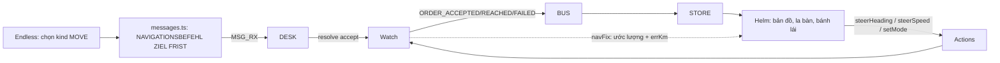

# Desk UI G5 — Design

Trạng thái: **ĐÃ DUYỆT 2026-11-05**. Đi kèm `requirements.md`.

## 1. Kiến trúc

Sim giữ vị trí thật và quyết định tới/hết hạn; UI chỉ thấy ước lượng (D3).

## 2. Thay đổi sim-core

| Mục | Thay đổi |
|---|---|
| `balance.json` | mục `move` (`chance`, `minKm`, `maxKm`, `assumedKn`, `marginFactor`, `arriveKm`) và `nav` (`driftPerKm`, `baseErrKm`) |
| `messages.ts` | `Kind` thêm `MOVE`, mạng `HQ`; `Generated.move?`; pool tell của `MOVE` = fist/timestamp |
| `traffic.ts` | `assessTells` bỏ `grid`/`bearing` cho `NAVIGATIONSBEFEHL` |
| `options.ts` | mô-đun `map`; thiếu `map` = bật |
| `watch.ts` | `inject(id, forged, kind)`, chọn `MOVE` trong `endlessNext`; lệnh hiệu lực, kiểm tới/hết hạn; `navFix()`; sự kiện mới |
| `events.ts` | `ORDER_ACCEPTED`, `ORDER_REACHED`, `ORDER_FAILED`; chủ đề PM `orderFailed` |
| `pm.ts` | chủ đề `orderFailed` từ Thuyền trưởng |

Không đổi: Enigma, auth, sonar, detection, luật G3, `send`.

## 3. Quy mô và hạn chót

Một ô con là 10 km và tàu đi tối đa ~17 kn, nên đích cách 10–25 km (`minKm`–`maxKm`) là vài chục phút sim-time; hạn chót = quãng đường / 8 kn × 1.5. Bán kính tới = 5 km (nửa ô con). Sai số trôi 3% quãng đường nên luôn nhỏ hơn bán kính tới trong một chuyến thường.

## 4. Helm

Lớp phủ `.dhelm` trong cảnh desk (không đụng cảnh P5/classic). Bản đồ là SVG do `desk/helm.ts` dựng; cập nhật theo khung chỉ khi `navFix()` hoặc hướng đổi. Bánh lái là SVG kéo bằng con trỏ, ánh xạ góc con trỏ sang hướng lệnh rồi gọi `steerHeading(delta)` (có giới hạn tần suất). La bàn là SVG xoay theo hướng tàu từ telemetry sẵn có.

## 5. Điểm

`ORDER_REACHED` +30 Ration, `ORDER_FAILED` −25 Ration (desk, lưu trong `desk.v1`; mỗi sự kiện chỉ tính một lần nhờ so với số đã thấy).
