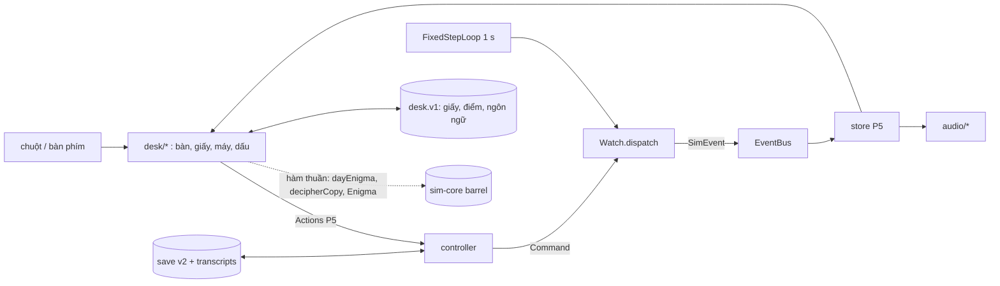

# Desk UI — Design

Trạng thái: **ĐÃ DUYỆT 2026-11-04**. Đi kèm `requirements.md`.

## 1. Kiến trúc



- **Dùng lại nguyên** từ P5: `controller`, `store`, `sim/loop`, `sim/session`, `sim/transcripts`, `audio/*`, `refusal`, `diag`, `input/modes` (mở rộng chế độ), cutaway tàu (`scene/boat.ts`), ngăn kéo auth/sonar.
- **Mới:** thư mục `packages/radio-ui/src/desk/` (scene bàn làm việc), `src/i18n/` (bảng chuỗi), `tools/art/desk*.ts` (sprite). Chọn bằng `?ui=desk` hoặc Settings; P5 vẫn mặc định (D7).
- Desk **không tự giữ trạng thái gameplay**: mọi quyết định đi qua `Actions` của P5 (`resolve`, `repeat`, `challenge`, `check`, `report`, `toggleSilence`, `setMode`...). Trạng thái riêng của Desk chỉ là trình bày (giấy đặt ở đâu, đã kẹp chưa) và điểm.

## 2. Bố cục desktop (logic 640×360, scale nguyên)

```text
x: 8            140                              424                 632
y:8  +-----------------------------------------------------------------+
     | MISSION (kẹp giấy, nổi trên cutaway)   CUTAWAY TÀU P5   ĐIỂM  II |
y:100+------------+-----------------------------------+----------------+
     | CHÂN DUNG  |                                   | TELETYPER      |
     | người ở    |          MẶT BÀN                  | đèn tin đến,   |
     | cửa        |   (giấy tự do: Input, Output,     | khe ra giấy,   |
     | 132×128    |    Daily Orders, Manual,          | nút xin lặp    |
y:236+------------+    Transcript...)                 +----------------+
     | BẢNG ĐIỀU  |                                   | ECHO STAMPER   |
     | KHIỂN TÀU  |  ngăn kéo mép trái: giấy trắng,   | (kéo ra bàn)   |
     | cần lặn,   |  dấu thường, ghim, thùng rác,     +----------------+
     | tốc độ,    |  Manual, Daily Orders             | MÁY ENIGMA     |
     | silence,   |                                   | tay kéo: trượt |
     | báo cáo,   |                                   | phủ nửa phải   |
     | đồng hồ TX |                                   | mặt bàn        |
y:352+------------+-----------------------------------+----------------+
```

- Máy Enigma ở trạng thái thu gọn chỉ lộ tay cầm và cửa sổ rotor; kéo ra thì trượt phủ nửa phải mặt bàn (như tham chiếu), đẩy vào để thấy giấy.
- Echo Stamper cũng có hai trạng thái (thu/kéo ra); khi kéo ra, tờ giấy đặt vào khe dưới máy mới đóng được.
- Transcript là một tờ mở giữa mặt bàn khi có thoại, chặn thao tác khác tới khi đọc xong hoặc bỏ qua.
- Mission là tờ kẹp ở góc trên trái, thu nhỏ được.
- Đồ vật ánh xạ sang bản tham chiếu: buzzer, bút, máy in tin (Teletyper), thùng rác, ghim, ngăn giấy, dấu thường, Transcript, Daily Orders, ngăn Manual. Roster ở G4.

## 3. Mô hình giấy

```ts
type PaperKind = "input" | "output" | "orders" | "manual" | "transcript" | "mission" | "citation" | "note";
interface PaperFace { readonly fields: Record<string, string>; readonly stamps: StampMark[]; readonly signature: boolean }
interface StampMark { readonly slot: "echo" | "regular1" | "regular2"; readonly kind: "true" | "false" | "blue" | "red" }
interface Paper {
  readonly id: string;               // ví dụ "in:3:2" = Input của rxId 3, attempt 2
  readonly kind: PaperKind;
  readonly rxId: number | null; readonly attempt: number | null;
  face: "front" | "back"; x: number; y: number; z: number;   // vị trí trên bàn (logic px)
  state: "desk" | "held" | "clipped" | "handed" | "trashed" | "drawer";
  clipGroup: string | null;
  readonly front: PaperFace; back: PaperFace;
}
```

- Nội dung mặt trước của Input/Output **dẫn xuất từ store** (`rx`, `attempts`, `copy`, `analysis`), không lưu bản riêng: tránh lệch với sim.
- Dấu và chữ ký là **thao tác của người chơi**, lưu trong `desk.v1` (khóa localStorage riêng, validate kích thước/miền như transcripts của P5).
- Dấu Echo là **nguồn sự thật duy nhất** cho quyết định: nó tồn tại khi và chỉ khi `resolve` đã được sim chấp nhận cho tin đó. Khi khôi phục, dấu Echo được dựng lại từ `MSG_RESOLVED`, không từ `desk.v1`.

## 4. Ánh xạ thao tác → lệnh sim

| Thao tác Desk | Gọi | Ghi chú |
|---|---|---|
| Teletyper: xin lặp | `actions.repeat()` | in tờ Input attempt mới |
| Gõ phím máy | `store` copy (như P5) | không phải `Command` |
| Xác nhận giải mã | `actions.decode()` (G1) / `decipherCopy` với vị trí người đặt (G2) | |
| Bảng auth: challenge / check | `actions.challenge()`, `actions.check()` | ngăn kéo P5 |
| Đóng Echo TRUE/FALSE | `actions.resolve("accept" \| "reject")` | **chỉ lúc tay đóng hạ xuống**; công tắc chỉ là trạng thái UI |
| Dấu thường, ký, kẹp, giao | không | trình bày + Mission + điểm |
| Bảng điều khiển tàu | `setMode`, `steerSpeed`, `steerHeading`, `toggleSilence`, `report` | |
| Thùng rác | không | luật giấy ở UI (G1), lỗi ở G3 |

Hệ quả: log lệnh của sim **giống hệt** P5 cho cùng quyết định; replay và save v2 không đổi.

## 5. Máy Enigma tương tác

- **G1:** như P5, cửa sổ hiện indicator của tin, phím ghi copy, đèn lampboard chỉ trang trí theo bản rõ đã giải.
- **G2:** máy giả lập thật trong UI bằng `new Enigma({...dayEnigma(seed, 1), positions})`:
  - Công tắc nguồn; nắp rotor chỉ mở khi tắt nguồn (như Manual tham chiếu).
  - Lăn chuột trên từng vòng: ±1 chữ; bàn phím: chọn vòng bằng ←/→, đổi chữ bằng ↑/↓.
  - Mỗi phím: `press()` trả chữ sáng trên lampboard, cửa sổ đổi theo `getPositions()`.
  - Space kết thúc nhóm: đặt lại vị trí đầu nhóm kế tiếp tính từ vị trí người chơi đặt (cùng thuật toán `decipherCopy`), nên lỗi chỉ lan trong một nhóm như sim. `?` vẫn bước rotor và không sáng đèn.
  - Bản rõ chính thức: `decipherCopy(seed, 1, viTriNguoiDat, copy)`; check letter: `checkLetterMatches(dayTable, from, d)` qua `watch.checkMatches`.
- Khóa ngày chỉ hiện trên Daily Orders (D2 sửa đổi). Vị trí mỗi tin là indicator gửi rõ trên tờ Input, đúng như thực tế.

## 6. Daily Orders, Manual, Transcript

- **Daily Orders** là tài liệu dựng từ dữ liệu công khai: ngày, khóa ngày (G2), danh sách tell cần soát (bốn tell hiện có + check letter), Stamping Rules (G1 cố định: Input nhận Echo ở mặt sau, Output nhận dấu đỏ ở mặt sau), đài đã biết (`worldCtx().callsigns`, fist đã biết), tin tức (văn bản viết sẵn theo ngôn ngữ, chọn bằng RNG thẩm mỹ), trang kết thúc.
- **Manual** là văn bản tĩnh trong bảng chuỗi, có mục lục.
- **Transcript:** bảng thoại `i18n/dialogue.<lang>.json` theo khóa sự kiện; mỗi mục có người nói, chức vụ, các biến thể; chọn biến thể bằng `decorRng`. Thoại sau `MSG_RESOLVED` được dùng `correct` (đã lộ theo D4).

## 7. Điểm (G2)

- Bộ đếm cục bộ, không phải `Command`: +1/−1 theo so khớp phím gõ với ký tự tờ Input tại vị trí đó; thưởng hoàn thành: Mission đủ bước (bảng trong `balance`-like file của UI, `src/desk/score.json`).
- Lưu trong `desk.v1`; tính lại được từ thao tác đã lưu; không vào save v2 và không ảnh hưởng replay.
- Đồng hồ 2 phút là tùy chọn trong Settings menu; chỉ báo ở G2.

## 8. Đa ngôn ngữ

- `packages/radio-ui/src/i18n/en.ts` (bộ khóa gốc) và `vi.ts` (kiểu `Record<MsgKey, string>` nên thiếu khóa là lỗi biên dịch); hàm `t(key, vars)` thuần, test bảng khóa đủ ở cả hai ngôn ngữ (`test/i18n.test.ts`).
- Glyph tiếng Việt: bản `latin` của Silkscreen và VT323 không có dấu tiếng Việt, và Silkscreen không có subset tiếng Việt. Đã thêm `vt323-vietnamese-400-normal.woff2` (quyết định §13.3, Stage 1); Desk dùng VT323 cho nhãn khi `lang=vi`. Không tải font từ ngoài lúc chạy.

## 9. Art (TEMPORARY, sinh bằng `tools/art`)

Mặt bàn, khung cột trái, bảng điều khiển tàu (cần gạt, nút, đồng hồ), Teletyper (đèn, khe, nút), Echo Stamper (2 trạng thái + công tắc + đèn), máy Enigma (thu/kéo ra, nắp mở, 4 cuộn rotor dọc, công tắc nguồn, lampboard), giấy (Input, Output, Daily Orders, Manual, Transcript, Mission: hai mặt), dấu Echo TRUE/FALSE, dấu thường xanh/đỏ, bút, ghim, thùng rác, ngăn kéo, 4–6 chân dung người ra vào (biến thể của bộ portrait P5). Biểu tượng trung tính, không quốc huy thật.

## 10. Kiểm thử

- Vitest: mô hình giấy (lật, kẹp, giao, luật thùng rác), ánh xạ Echo → đúng một `resolve`, dựng lại dấu Echo từ log, máy Enigma UI cho cùng bản rõ với `decipherCopy` (property test với fast-check: chuỗi ngẫu nhiên, có `?`, nhóm lệch), odometer + double-step, điểm, bảng i18n đủ khóa, validate `desk.v1` với dữ liệu xấu, invariants tĩnh (không `truthOf`, barrel-only, không `innerHTML`).
- Edge headless qua CDP (như các lần trước): chơi trọn ca `?ui=desk`, reload, `en`/`vi`, ảnh chụp các trạng thái.

## 11. Quyết định và đánh đổi

| Quyết định | Lý do | Phương án khác |
|---|---|---|
| `?ui=desk` trong `radio-ui` | dùng lại controller/store/session, không package mới | package riêng: trùng lặp logic |
| Echo đóng = gửi `resolve` | dấu không xóa được, khớp lệnh duy nhất | gửi khi giao: dấu và quyết định lệch nhau |
| UI dùng `dayEnigma`/`decipherCopy` | rotor do người chơi đặt mà không sửa sim | thêm helper quan sát vào `Watch`: sửa sim-core |
| Điểm ngoài save | không ảnh hưởng replay tất định | điểm là `Command`: phải sửa sim (để G3) |
| Desktop-only | chỉ dẫn người dùng | giữ flow mobile của P5: nhân đôi công sức |

## 12. Rủi ro
- Khối lượng art và nội dung (thoại, tin tức, Manual hai ngôn ngữ) lớn; chất lượng art code-drawn có giới hạn.
- Kéo thả cần đường thay thế bằng bàn phím đầy đủ; dễ thiếu sót.
- Font tiếng Việt: đã duyệt (§13.3) và đã thêm subset VT323 ở Stage 1; nhãn tiếng Việt dùng VT323 nên khác nét chữ với Silkscreen của bản tiếng Anh.
- Bố cục dày đặc ở 640×360; có thể phải bớt chi tiết sau lần chơi thử.
- Các luật False Echo suy từ ảnh có thể sai ở chi tiết.

## 13. Quyết định (người dùng trả lời 2026-11-04)
1. **Đã duyệt** sửa đổi D2: UI được gọi `dayEnigma`, `decipherCopy`, `Enigma` với seed của phiên.
2. **Desk thay P5 làm mặc định sau khi G1 được duyệt**; P5 giữ làm tùy chọn trong Settings, P4 vẫn ở `?ui=classic`.
3. **Font tiếng Việt:** thêm subset `vietnamese`/`latin-ext` của cùng nguồn `@fontsource` (OFL, tarball, không thành dependency), ghi hash và license; nếu Silkscreen không có subset tiếng Việt thì dùng VT323 cho chữ tiếng Việt.
4. **Đơn vị điểm:** *Ration* (en) / *Khẩu phần* (vi).

Còn mở: người chơi có tên và chức vụ riêng trong thoại không (tham chiếu dùng "Lieutenant").
