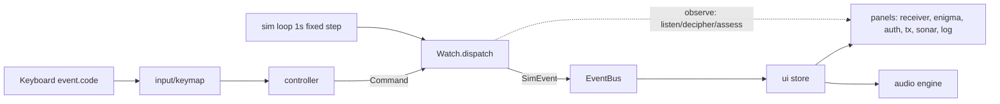

# P4 Radio Room UI — Design

Trạng thái: **DRAFT, chờ duyệt**. Đi kèm `requirements.md`.

## 1. Tổng quan kiến trúc



Gói mới `packages/radio-ui`, phụ thuộc workspace vào `@uboat/sim-core`. Ranh giới: UI → sim-core qua barrel; sim-core không biết UI tồn tại.

## 2. Công nghệ
- TypeScript strict (cùng cấu hình sim-core), DOM thuần, không framework.
- `vite@8.3.5` làm dev server/bundler (devDependency duy nhất mới).
- Web Audio API cho Morse và hydrophone.
- Test: vitest (đã có) với môi trường DOM nhẹ cho logic thuần; phần âm thanh/vẽ kiểm bằng trình duyệt thật.

## 3. Cấu trúc thư mục

```text
packages/radio-ui/
  index.html
  src/
    main.ts            # khởi tạo, nối các phần
    sim/loop.ts        # bộ tích lũy thời gian, bước cố định
    sim/session.ts     # seed + commandLog, lưu/khôi phục, replay
    store.ts           # trạng thái UI dẫn xuất từ SimEvent
    input/keymap.ts    # event.code -> hành động, khóa bảng phím
    audio/morse.ts     # Segment[] -> OscillatorNode theo đồng hồ audio
    audio/hydrophone.ts# tiếng chân vịt theo blade rate
    panels/receiver.ts panels/copy.ts panels/enigma.ts
    panels/authTable.ts panels/transmit.ts panels/sonar.ts panels/log.ts
    panels/summary.ts
    style.css          # token màu/khoảng cách
  test/
```

## 4. Bố cục màn hình (desktop)

```text
+--------------------------------------------------------------+
| STATUS: mode | speed | hull | TX total | antenna | clock      |
+------------------------+-------------------------------------+
| RECEIVER (waveform)    | AUTH TABLE 26x26 + cursor           |
| COPY pad  [group][..]  | challenge cell / reply / result     |
| ENIGMA output + marks  | HEADER + tells                      |
+------------------------+-------------------------------------+
| TRANSMIT: repeat | challenge | accept | reject | report | silence |
+------------------------+-------------------------------------+
| SONAR: bearing dial, contacts, hydrophone | EVENT LOG       |
+--------------------------------------------------------------+
```

Tông phosphor xanh trên nền tối; token màu định nghĩa trong `style.css`, cảnh báo có thêm nhãn chữ (R9.2). Chế độ khẩn cấp (R6.3) viền đỏ + thu gọn các bàn không cần, giữ lệnh thuyền ở giữa.

## 5. Luồng dữ liệu

- **Vòng lặp:** `requestAnimationFrame` chỉ cộng `elapsed` vào bộ tích lũy; mỗi 1000 ms (theo hệ số tốc độ) gọi `watch.step()` đúng một lần cho mỗi bước, giới hạn số bước bù mỗi khung để tránh xoắn ốc. Vẽ không ảnh hưởng sim (R7.1).
- **Sự kiện → store:** `bus.subscribe` đẩy `SimEvent` vào reducer của `store`; panel đăng ký theo loại sự kiện và chỉ vẽ lại phần đổi.
- **Lệnh:** controller dịch phím thành `Command`, gọi `watch.dispatch`, nhận `boolean`; `false` thành thông báo lý do (R5.3).
- **Quan sát:** `decipher/assess/checkMatches/dayTable/worldCtx/listen` chỉ gọi khi người chơi hành động hoặc theo chu kỳ vẽ sonar; không có tác dụng phụ (đã có test ở sim-core).
- **Lưu:** `session.ts` ghi `{seed, commandLog}` vào `localStorage` (bọc try/catch); tải lại gọi `replay(seed, log, untilTick)`.

## 6. Âm thanh
- `audio/morse.ts` lấy `Segment[]` từ `schedule(tokens, fist, cosmeticRng)`; lên lịch `OscillatorNode`+`GainNode` trên `AudioContext.currentTime` với bao gain ngắn tránh click.
- Tần số tone cố định theo đài (lấy từ hash callsign) để người chơi phân biệt đài.
- Nhiễu nền: noise buffer, mức theo `snrDb` của `MSG_RX`.
- `audio/hydrophone.ts`: xung theo `bladeRateHz`, mức theo `snrDb`; pan theo bearing.
- `AudioContext` chỉ tạo sau thao tác đầu của người dùng (R1.4).

## 7. Bàn phím
Bảng phím khai báo một nơi (`keymap.ts`), khóa theo `event.code`: A–Z, 0–9, Space, Backspace, Enter, Tab (đổi bàn), Esc (tạm dừng), `?`; phím chức năng gán lệnh (ví dụ R: repeat, C: challenge, Y/N: accept/reject, K: check). Khi đang ở chế độ chép, chữ cái đi vào copy; chức năng dùng tổ hợp Ctrl/phím F để không đụng chữ. Chặn mặc định của trình duyệt trên các phím đã dùng.

## 8. Mô hình trạng thái UI (store)

```ts
interface RxView { rxId: number; attempts: { attempt: number; indicator: string; tokens: string; snrDb: number }[]; copy: string[]; resolved?: boolean }
interface UiState { rx: Map<number, RxView>; activeRx: number | null; challenge?: {row:string;col:string;reply?:string;result?:string};
  sonar: Map<number, {bearingDeg:number; bladeRateHz:number; guess:"escort"|"slow"}>; tx: {totalSec:number; keyed:boolean};
  boat: {mode:string; speedKn:number; hull:number}; emergency: boolean; log: string[]; ended?: WatchSummary }
```
Chỉ chứa dữ liệu mà người chơi biết; không có trường nào tới từ `truthOf`.

## 9. Xử lý lỗi và biên
- Không có Web Audio: UI vẫn chơi được bằng nhìn (hiện tokens dạng chấm gạch có bật/tắt), có thông báo.
- `localStorage` lỗi: bỏ qua lưu, báo một lần.
- Tab ẩn: tạm dừng sim tự động, không bù tick vô hạn.
- Command log quá lớn: giới hạn bằng số lệnh (ca trực ngắn nên không cần nén ở P4).

## 10. Chiến lược kiểm thử
- Vitest: `keymap` (chỉ nhận phím được phép), bộ tích lũy vòng lặp (bước cố định, giới hạn bù), reducer store (sự kiện → trạng thái), `session` (lưu/khôi phục = replay đúng).
- Kiểm tra tĩnh: grep mã UI không có `truthOf`; ESLint/tsc strict.
- Trình duyệt thật: chơi trọn ca trực, chụp ảnh các trạng thái chính (nhận tin, giải mã, challenge, cảnh báo Bridge, tổng kết); kiểm console không lỗi.
- Âm thanh/độ vui: ghi rõ **chưa kiểm chứng** nếu chưa nghe/chơi thật.

## 11. Quyết định và đánh đổi
| Quyết định | Lý do | Phương án khác |
|---|---|---|
| DOM thuần | ít dependency, đủ cho UI dạng bảng | React/Svelte: tiện hơn nhưng thêm chuỗi cung ứng |
| Bước sim cố định 1 s trong rAF | giữ tất định | `setInterval`: trôi khi tab ẩn |
| Lưu seed+commandLog | đúng nguyên tắc save/load | snapshot: dễ lệch với sim |
| Không hiện hazard/Intel số | giữ tension, tránh biến thành bài toán tối ưu | hiện số: dễ debug nhưng mất cảm giác |
| Tự pause khi tab ẩn | tránh mất ca trực vô ích | để chạy: có thể chìm tàu khi không nhìn |

## 12. Rủi ro
- Chất lượng âm Morse/độ căng chỉ đánh giá được khi nghe và chơi thật.
- Bố cục dày thông tin dễ quá tải: có thể cần bớt bàn sau lần chơi thử đầu.
- Phím chức năng có thể đụng phím tắt trình duyệt; cần thử trên Chrome/Edge.
