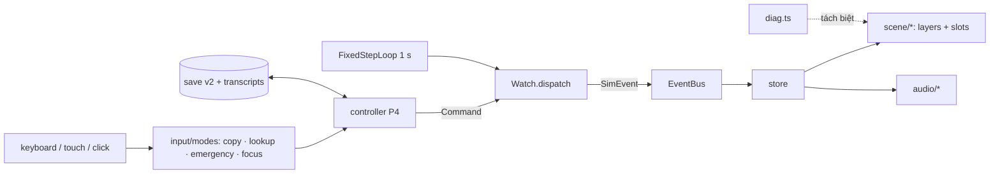

# P5 Radio Room Presentation — Design

Trạng thái: **Đã duyệt và triển khai (Stage 1-6)**. Đi kèm `requirements.md`.

## 1. Kiến trúc



Giữ nguyên từ P4: `controller`, `store`, `sim/loop`, `sim/session`, `audio/*`, `input/keymap`, `refusal` (sửa nhỏ, §7). Thay: `panels/*` và `style.css` bằng `scene/*`. UI P4 cũ giữ ở `?ui=classic` tới khi P5 được kiểm chứng, rồi xóa (quyết định của người dùng).

Ranh giới B1–B6 trong requirements giữ nguyên; `test/invariants.test.ts` mở rộng cho thư mục `scene/`.

## 2. Hệ thống scene

- **Khung logic 640×360.** Mỗi vùng là một `<section class="slot">` định vị tuyệt đối trong `.scene` theo tọa độ logic, nhân với `--px` (hệ số nguyên). Desktop: `--px = max(1, floor(min(vw/640, vh/360)))`. Phần dư là viền tối.
- **Lớp sprite** (z từ dưới lên): `bg` (khung/vỏ) → `body` (tàu, chân dung, giấy, vỏ máy) → `parts` (phím, đèn, cần gạt: sprite sheet, trạng thái bằng `background-position`) → `text` (DOM thật: Silkscreen/VT323) → `fx` (CRT/noise tùy chọn, chớp cảnh báo).
- Sprite sheet và nhịp frame lấy từ `assets/manifest.json`; animation chỉ đổi `background-position` bằng class/`steps()` CSS; không vẽ lại DOM mỗi khung.
- Nút là `<button>` có nhãn, trạng thái `:focus-visible` vẽ bằng viền pixel; sprite chỉ là nền.

### Bố cục desktop (tọa độ logic, đơn vị px)

```text
x:  8                    148                          424        632
y:8 +--------------------------------------------------------------+  banner tàu 624×92 (nút pause 24×24, góc phải)
    +---------+ +---------------------------+ +------------------+
y:108| PORTRAIT| | TELEGRAM 268×104          | | MACHINE 208×244  |
    | 132×152 | |  header · auth mini-grid  | |  4 cửa sổ        |
    |         | |  · dấu triện              | |  lampboard 3 hàng|
y:216+---------+ +---------------------------+ |  bàn phím QWERTZ |
    | GAUGES  | | COMMAND DOCK 268×22       | |  hàng số, ?, ⌫   |
y:264| 132×88  | +---------------------------+ |  cần Decode      |
    |         | | SECRET PAPER 268×110      | |                  |
    |         | |  copy theo group + bản rõ | |                  |
y:352+---------+ +---------------------------+ +------------------+
```

Command dock: Repeat · Challenge · Check · Accept · Reject · Report · Silence. Gauges: tổng giờ phát, đèn ăng-ten/đang phát, hull, tốc độ, hướng. Sonar, bảng auth đầy đủ và log là **ngăn kéo** mở từ mép (nút trên banner / phím tắt).

### Bố cục tablet (768–1024)
Hai cột: trái = banner gọn + điện tín + SECRET; phải = máy. Gauges thành hàng dưới banner. Ngăn kéo cho sonar/auth/log. Scale nguyên ×1 hoặc ×2 theo chiều rộng.

### Bố cục mobile (320–480)
Không scale cả cảnh. Thanh trên 320×64 logic (sprite crop riêng: tàu + chân dung nhỏ) ở scale 1. Thanh tab dưới: **Radio** (điện tín + SECRET + dock), **Máy** (cửa sổ, lamp, phím với mục tiêu chạm ≥ 44 px: phím lớn hơn bằng grid 10 cột có cuộn dọc nếu cần), **Auth**, **Sonar**, **Log**. Mỗi tab là DOM thật, không cuộn ngang; tab bar dùng `role="tablist"`.

## 3. Ánh xạ trạng thái → hình ảnh

| Nguồn (store) | Hiển thị |
|---|---|
| `boat.mode` | mực nước/vị trí tàu trong cutaway (3 trạng thái), nhãn chữ |
| `boat.speedKn` | tốc độ quay chong chóng (frame, `steps()`) |
| `boat.hull` | 0–100%: 4 mức vết nứt/đèn chập chờn; hull số hiện trên gauges |
| `emergency` | đèn đỏ cutaway, bóng thủy thủ, viền + nhãn "BRIDGE ALERT" |
| `tx.keyed`, `boat.antennaUp` | đèn xanh trên máy + gauges (kèm chữ) |
| `tx.locatedAtSec`, `tx.escortAtSec` | nhãn "LOCATED", "ESCORT" + chớp (tắt khi giảm chuyển động) |
| `rx` chưa đọc | đèn nhấp nháy trên điện tín/tab; chip chọn tin |
| copy | chữ trên SECRET paper; phím vừa gõ lún xuống |
| `analysis` | lamp sáng theo bản rõ (tuần tự, ~60 ms/chữ, tắt khi giảm chuyển động: hiện ngay); dấu triện KHỚP/KHÔNG KHỚP |
| portrait | `listening` (có MSG_RX đang phát), `writing` (đang gõ), `alert` (khẩn cấp), `hurt` (vừa `BOAT_DAMAGED`), mặc định `idle` |

Mọi dao động trang trí dùng `decorRng` riêng (mulberry32 từ hạt giống thẩm mỹ per-page); không bao giờ gọi RNG của sim.

## 4. Máy mật mã và chế độ phím

- Bàn phím trên máy: bố cục QWERTZ như Enigma (hàng số, 3 hàng chữ) + `?` + Space + Backspace + cần Decode. Phím là `<button>` (chuột/chạm). Gõ phím vật lý dùng `event.code`, độc lập bố cục.
- **Chế độ phím (`input/modes.ts`)**: một máy trạng thái hữu hạn quyết định cách giải thích phím.
  - `copy` (mặc định): chữ/số/Space/Backspace/`/`→`?`/Enter vào bản copy.
  - `lookup`: chữ chọn hàng rồi cột; Enter/Alt+L thoát.
  - `emergency`: U/P/D, 0–9 tốc độ, mũi tên hướng; chữ khác vẫn rơi về copy.
  - `focus`: khi tiêu điểm nằm trên điều khiển không phải vùng copy, `Tab`/`Shift+Tab` điều hướng bình thường và Enter/Space kích hoạt điều khiển đó (khắc phục lỗi P4 phải `blur` sau click chuột).
  - Ctrl/Meta không bao giờ bị chặn. Bảng phím khai báo một nơi (`keymap.ts`), có test cho từng chế độ.

## 5. Save, replay, silent rebuild

- Save game (`uboat-radio.save.v2`): `{v:2, seed, untilTick, commands}`. Validate đúng như P4 (kiểu, miền, tick không giảm, tối đa 5000 lệnh, tối đa 2 MB). Khôi phục: `replay(seed, commands, untilTick)`.
- Bản chép (`uboat-radio.copy.v1`): `{v:1, seed, entries:[{rxId, attempt, text}]}`; `text` chỉ `[A-Z0-9? ]`, ≤ 400 ký tự/entry, ≤ 64 entry, ≤ 64 KB; chỉ dùng nếu `seed` trùng save. Ghi khi gõ (debounce) và `pagehide`. Không bao giờ vào log/diagnostics.
- **Silent rebuild:** `rebuildStore(store, events, commands, {silent:true})`: reducer chạy nhưng cờ `silent` ngăn (a) xếp hàng audio, (b) kích hoạt khẩn cấp cho sự kiện cũ, (c) chớp cảnh báo. Sau rebuild, `emergency` chỉ còn hiệu lực nếu `untilSec > tSec` của tick khôi phục. Controller đăng ký bus **sau** rebuild.
- **Tương quan `AUTH_RESULT`:** `Store.noteCheck(rxId)` đặt `pendingCheck` ngay trước `dispatch({check})`; `AUTH_RESULT` đồng bộ trong `dispatch` nên gán đúng tin. Khi rebuild: với mỗi `AUTH_RESULT` tại `tSec=t`, chọn `check` đầu tiên chưa dùng có `tick===t` mà tin tương ứng đang `reply!==null && result===null` (đúng điều kiện sim chấp nhận). Test: hai `check` cùng tick, một bị từ chối.
- Tick hiện tại là `untilTick`; đặt tên đổi từ `tick` của P4 để khớp spec; migration: đọc `v:1` (P4) → chuyển thành `v:2`.

## 6. Vòng lặp và lệnh

`FixedStepLoop` của P4 giữ nguyên (bước 1000 ms, tối đa 5 bước/khung, bỏ phần dư, kẹp khung 2 s). Thêm bộ đếm `clamped` (số lần chạm trần) cho diag. Hàng đợi lệnh: sự kiện nhập liệu gọi `controller.send` đồng bộ giữa các bước; sim log `tick` hiện tại, nên thứ tự lệnh cùng tick là thứ tự gọi. Tab ẩn: `autoPause()` + lưu; người chơi tiếp tục bằng Esc/nút.

## 7. Từ chối lệnh không bịa lý do

`dispatch` chỉ trả `boolean`. `refusal.ts` đổi thành:
- Trả `{ kind:"refused", facts: string[] }`, `facts` chỉ gồm điều quan sát được từ store/đèn: "Radio silence đang BẬT", "Ăng-ten đang chìm", "Tin #n đã xử lý", "Chưa có reply".
- Câu hiển thị: "Lệnh không được chấp nhận. Quan sát: …" (không nói "vì …"). Điều kiện kiểm tra trước (chưa có tin nào) vẫn chặn trước dispatch với thông báo riêng, vì đó là quyết định của UI, không phải của sim.

## 8. Sonar, khẩn cấp, ngăn kéo

- Ngăn kéo sonar: vòng bearing (SVG), danh sách contact (bearing nhiễu, blade rate, escort/slow), nút Listen (hydrophone). Không có khoảng cách. Đóng/mở bằng nút và phím; focus bị bẫy trong ngăn kéo khi mở (`inert` cho phần còn lại), Esc đóng.
- Khẩn cấp: lớp phủ không che điều khiển lệnh tàu; dock lệnh tàu phóng lớn; Esc tắt. Chỉ kích hoạt từ sự kiện mới (silent rebuild loại sự kiện cũ).

## 9. Asset pipeline

- Thư mục: `packages/radio-ui/assets/` (`sprites/*.png`, `fonts/*.woff2` + `LICENSE-*`, `manifest.json`). Import qua Vite (`?url`), có hash tên file; không CDN.
- **Placeholder do trợ lý tạo:** script tất định `packages/radio-ui/tools/art/generate.mjs` (chỉ API Node có sẵn: `zlib`, `fs`) sinh PNG indexed-color theo bảng màu token; cùng đầu vào cho cùng byte (có test hash). Mỗi asset gán `"status": "TEMPORARY"`, `"origin": "generated by tools/art/generate.mjs"`, `"license": "project license (original work)"`.
- Sprite cần có: khung ngoài + đinh tán, cutaway tàu (3 trạng thái nước + chong chóng 4 frame + thủy thủ + đèn đỏ), chân dung (idle/listening/writing/alert/hurt), điện tín (giấy + dấu triện 2 trạng thái), giấy SECRET, vỏ máy, 4 cửa sổ, lampboard (sáng/tắt), phím (lên/lún), cần gạt (2 trạng thái), đèn xanh/đỏ, nút pause.
- `manifest.json` mỗi mục: `id, path, width, height, frames:{w,h,count,fps?}, origin, license, status, sha256`. Một test kiểm: file tồn tại, kích thước khớp, hash khớp, không asset nào thiếu license, `TEMPORARY` được liệt kê (và báo cáo cuối nêu số lượng).
- Font: `fonts/silkscreen-latin-400-normal.woff2` (sha256 `e6c72ea4…0b4cc`) và `fonts/vt323-latin-400-normal.woff2` (sha256 `8ddbebcc…5b6`), nguồn tarball `@fontsource/*@5.3.0` (OFL-1.1), kèm `LICENSE-OFL-*.txt`; **không** thêm làm dependency. `font-display: swap`; rơi về monospace nếu lỗi.
- Lỗi tải asset (`onerror`/`document.fonts`): đặt class `no-sprites`, nền CSS dùng token màu; ghi mã `ASSET_LOAD` vào diag.
- Cam kết: sprite placeholder **cố gắng đẹp nhất có thể** nhưng nhãn `TEMPORARY` giữ cho tới khi người dùng chấp nhận hoặc thay asset.

## 10. Chẩn đoán (`diag.ts`)

Bộ đếm trong bộ nhớ, không gửi mạng, không ghi nội dung tin/bản chép: `sessionId` (ngẫu nhiên, không liên hệ danh tính), `tick`, `frameMs` (p50/p95/max, cửa sổ 300 khung), `catchUpClamped`, `assetErrors[]`, `audioErrors[]`, `saveErrors[]` (mã lỗi ngắn). Hiển thị ở lớp riêng `?diag=1` (mặc định ẩn; tách khỏi thông tin cho người chơi). Test: không có trường chứa chuỗi bản chép.

## 11. Chiến lược kiểm thử

- Vitest: loop (có `clamped`), save v1→v2, parse save và transcript (hostile input), reducer (silent vs live), cô lập attempt, tương quan challenge (nhiều `check` cùng tick), modes (copy/lookup/emergency/focus), refusal facts, manifest, diag không rò nội dung, invariants tĩnh.
- Trình duyệt thật (Playwright/Chromium): chơi trọn ca trực bằng phím và chạm; kiểm 320/390/480, 768/1024, 1280/1920: không cuộn ngang, mục tiêu chạm ≥ 44 px ở mobile, focus nhìn thấy; reduced-motion; `?diag=1`; console sạch.
- Chụp ảnh các trạng thái chính; **không** kết luận độ khớp thẩm mỹ với ảnh tham chiếu: chỉ người dùng đánh giá.

## 12. Quyết định và đánh đổi

| Quyết định | Lý do | Phương án khác |
|---|---|---|
| Giữ DOM/CSS + sprite sheet | không đổi engine, chữ/điều khiển truy cập được | Canvas/Phaser: lệch với yêu cầu, khó a11y |
| Scale nguyên + viền | giữ pixel sắc nét | Scale phân số: mờ/méo pixel |
| Mobile tab/drawer | không thu nhỏ cả cảnh | Scale cảnh xuống 0.5: chữ không đọc được |
| Alias tsconfig + Vite tới barrel | sim-core không có `exports`/build, repo không có root workspace manifest; không sửa sim-core | Root workspaces + `main` cho sim-core: sửa package.json sim-core |
| Placeholder tạo bằng script tất định | tái lập, có hash, không bản quyền ngoài | Dùng sprite của ảnh tham chiếu: vi phạm R10.4 |
| `?ui=classic` tạm thời | an toàn khi chuyển | Thay luôn: mất đường lui |

## 13. Rủi ro
- Chất lượng thẩm mỹ của placeholder có thể chưa đạt kỳ vọng; cần vòng phản hồi của người dùng sau Stage 2.
- Bàn phím trên máy và phím vật lý chồng lấn trên mobile (bàn phím ảo): ưu tiên phím trên máy và tránh focus vào input ẩn.
- Alt+chữ có thể va phím tắt trình duyệt/OS: chưa thử trên Mac/Edge.
- Vitest 5.1.0 cần Node ≥ 22.12; CI cần khớp (chưa kiểm tra workflow).
- Balance sim khiến nhiều lần xin lặp; ngoài phạm vi P5.

## 14. Nâng cấp và hoàn tác
Thêm mới trong `packages/radio-ui` + spec + ADR ngắn về alias linking; không đổi sim-core, VERSION, dependency. Save `v1` (P4) được đọc và chuyển sang `v2`. Hoàn tác: xóa `scene/`, `assets/`, `tools/`, khóa `uboat-radio.copy.v1`, về `?ui=classic` (P4); không cần migration ngược vì sim-core và định dạng lệnh không đổi.
